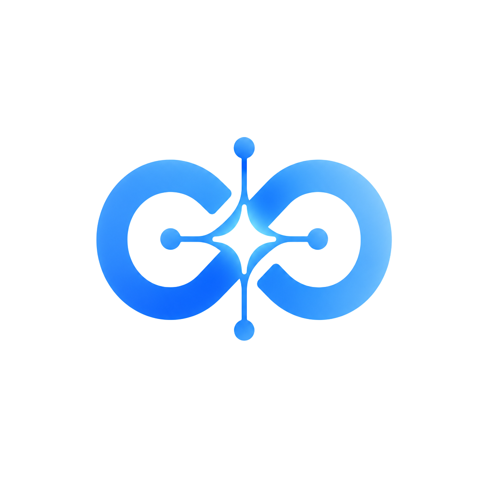

<p align="center">
  
</p>

<h1 align="center">LifeSync AI</h1>

<p align="center">
  Plataforma de produtividade que organiza tarefas, hábitos, metas e rotina com ajuda de inteligência artificial.
</p>

<p align="center">
  
  
  
  
  
</p>

---

## Sobre

O LifeSync AI junta em um só app o que normalmente fica espalhado em vários: lista de tarefas, calendário, hábitos, metas e um diário de humor. A IA usa esses dados para sugerir uma rotina, reorganizar o dia quando algo atrasa e apontar padrões (por exemplo, dias em que você costuma se sobrecarregar).

## Funcionalidades

- **Tarefas** com prioridade, prazo e repetição; tarefas recorrentes avançam sozinhas para a próxima data
- **Calendário** com sincronização com o Google Agenda (OAuth)
- **Hábitos e metas** com acompanhamento de progresso
- **Mood tracker** para registrar o humor ao longo dos dias
- **Relatórios** com gráficos de produtividade (Recharts)
- **Assistente de IA** (chat) com memória do contexto do usuário
- **IA aplicada à rotina:** gerar rotina, reorganizar o dia ou a semana, análise de padrões e mensagens de motivação
- **Onboarding**, login com e-mail/senha ou Google, recuperação de senha e página de acessibilidade

## Stack

| Camada | Tecnologias |
| --- | --- |
| Front-end | React 19, TypeScript, TanStack Start / Router / Query, Tailwind CSS, shadcn/ui, Framer Motion, Recharts |
| Back-end | Rotas de API server-side do TanStack Start, Supabase (PostgreSQL, Auth, RLS) |
| IA | Modelos Gemini via gateway de IA, chamados apenas no servidor |
| Integrações | Google Calendar (OAuth 2.0) |
| Testes | Vitest e Testing Library |

```
src/
├── routes/
│   ├── _authenticated/   # dashboard, tarefas, calendário, hábitos, metas, humor, IA…
│   └── api/              # endpoints de IA e da integração com o Google
├── components/           # componentes de interface
├── contexts/             # autenticação
├── lib/                  # cliente de IA, sincronização com o Google, insights
└── __tests__/            # testes unitários
supabase/migrations/      # schema e políticas do banco
```

## Rodando localmente

Requisitos: Node.js 20+ e um projeto Supabase.

```bash
git clone https://github.com/Victin7/LIFESYNC-AI.git
cd LIFESYNC-AI
npm install
cp .env.example .env   # preencha as chaves do Supabase, Google OAuth e IA
npm run dev
```

| Script | Descrição |
| --- | --- |
| `npm run dev` | servidor de desenvolvimento |
| `npm run build` | build de produção |
| `npm test` | testes com Vitest |
| `npm run lint` | verificação com ESLint |

## Autor

**Victor Sousa dos Anjos** · estudante de Análise e Desenvolvimento de Sistemas (UNICID)
[LinkedIn](https://www.linkedin.com/in/victor-s-anjos) · [GitHub](https://github.com/Victin7)
